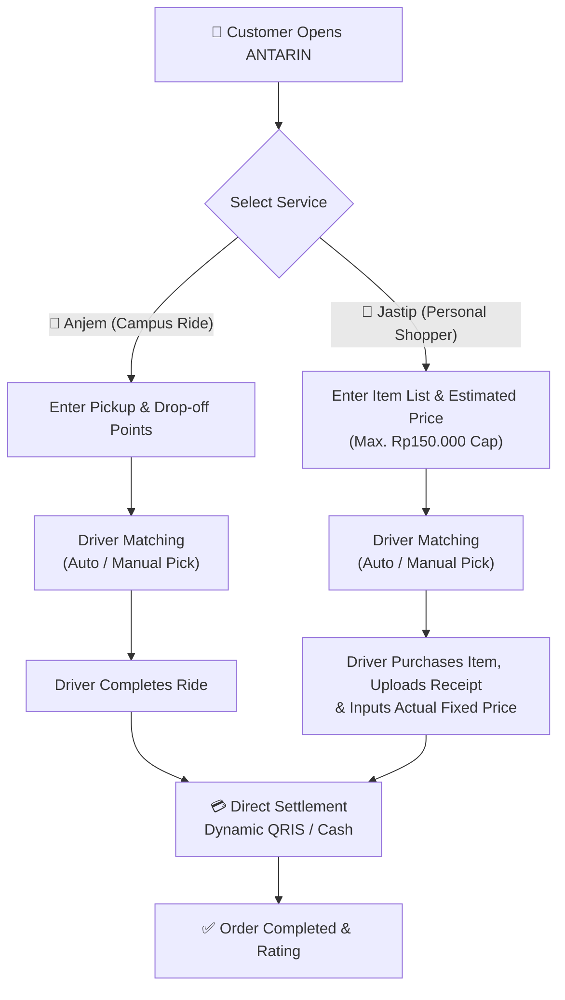

<!-- HERO BANNER -->
<div align="center">
  
</div>

<div align="center">

[](https://nextjs.org/)
[](https://react.dev/)
[](https://tailwindcss.com/)
[](https://vercel.com/)
[](#status--roadmap)

<br />

**[Live Demo](antarin-web-eight.vercel.app)** · **[Workflow Diagram](#how-it-works)** · **[Local Setup](#getting-started)** · **[Report Issue](https://github.com/abdulgani89/antarin-frontend/issues)**

</div>

---

> [!NOTE]
> **Prototype Mode:** This repository hosts the interactive frontend MVP for **ANTARIN**, designed for the Universitas Negeri Semarang (UNNES) student ecosystem. Core booking flows run with structured mock data while backend API and payment webhook integrations are staged in the roadmap.

## Interface Showcase

<div align="center">
  <table>
    <tr>
      <td align="center"><b>1. Home & Service Picker</b></td>
      <td align="center"><b>2. Split Jastip Order Form</b></td>
      <td align="center"><b>3. Driver & Receipt Flow</b></td>
    </tr>
    <tr>
      <td align="center">
        
      </td>
      <td align="center">
        
      </td>
      <td align="center">
        
      </td>
    </tr>
  </table>
  <sub><i>Mobile-first views captured in responsive viewport (390×844)</i></sub>
</div>

---

## Why ANTARIN?

Campus errands and rides around university areas are typically coordinated through messy group chats—leading to unclear fares, unverified drivers, and disputes over shopping totals.

> [!TIP]
> **Key Product & Architectural Decisions**
> - **Two-Step Jastip Reconciliation:** Customers submit an *estimated item price* upfront; drivers upload the purchase receipt and input the *actual fixed price* to eliminate price disputes.
> - **Zero Customer E-Wallet Balance:** Keeps the MVP lean and avoids ledger/regulatory overhead by using direct **Dynamic QRIS** and cash settlements.
> - **Campus Trust Guardrails:** Designed around UNNES Google SSO & Student ID (KTM) driver verification, online/offline driver toggles, and a **Rp150.000** per-order Jastip cap to limit financial risk.

---

## How It Works



---

## Core Modules & Roles

| Role | Key Capabilities |
| :--- | :--- |
| **Customer** | Book **Anjem** or **Jastip**, choose auto/manual driver matching, track estimated vs. final itemized cost, and submit post-order reviews. |
| **Driver** | Toggle online/offline availability, accept campus requests, upload shopping receipts with fixed pricing, and monitor earnings (min. withdrawal Rp20.000). |
| **Admin** | Review and approve student driver registrations (KTM verification) and oversee operational workflows. |

---

## Tech Stack

<div align="center">
  
</div>

- **Frontend (Implemented):** Next.js (App Router), React, Tailwind CSS
- **Deployment:** Vercel
- **Companion Backend Architecture (Planned):** PostgreSQL & Prisma (`users`, `orders`, `reviews`)

---

## Getting Started

```bash
# 1. Clone the repository
git clone [https://github.com/abdulgani89/antarin-frontend.git](https://github.com/abdulgani89/antarin-frontend.git)
cd antarin-frontend

# 2. Install dependencies
npm install

# 3. Copy environment variables (if applicable)
cp .env.example .env.local

# 4. Start the development server
npm run dev
```

Open `http://localhost:3000` in your browser (enable Chrome DevTools Mobile View for the intended experience).

<details>
<summary><b>📂 Click to view Project Structure</b></summary>

```text
antarin-frontend/
├── docs/               # Mobile UI screenshots for README showcase
├── public/             # Static icons, logos, and compressed assets
├── src/
│   ├── app/            # Next.js App Router pages (customer, driver, admin)
│   ├── components/     # Reusable UI components
│   └── data/           # Mock data and service configuration
├── .env.example        # Environment variable template
└── README.md
```

</details>

---

## Status & Roadmap

- [x] Mobile-first UI prototype for **Anjem** and **Jastip** flows
- [x] Split Jastip pricing flow (estimated price → receipt upload & actual price)
- [x] Driver status toggle & Admin approval interface
- [ ] Connect frontend to PostgreSQL/Prisma REST API
- [ ] Integrate UNNES Google SSO & Dynamic QRIS payment webhook

---

## Author

<div align="center">

**Muhamad Abdul Gani**

[](https://github.com/abdulgani89)
[](https://gamasrent.vercel.app)


</div>
